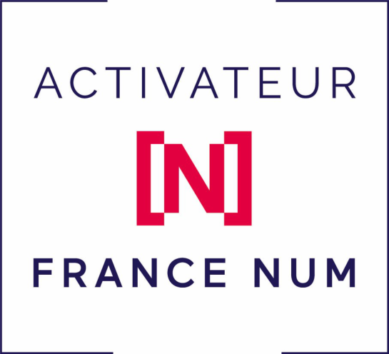

# Charles Lepoittevin

Développeur web, consultant IA et **Activateur France Num**, basé à Montpellier. Je conçois et je mets en production des applications web complètes — du prototype déployé en quelques jours à la plateforme qui tourne avec ses utilisateurs.

Je viens des **travaux publics** avant d'écrire du code, et j'en ai gardé la méthode : on coule les fondations avant de poser les finitions, on tient le planning, et un ouvrage n'est livré que lorsqu'il tient debout. C'est exactement comme ça que je construis un site.

## Ce que je fais

- **Applications web** : React, Vite, Next.js, PWA installables, temps réel, mode hors ligne.
- **Jeux et animations** : HTML5 Canvas, animation d'interface, jeux solo complets.
- **Intégration IA & IoT** : agents autonomes, systèmes embarqués communicants (ESP32), automatisations (n8n, LangChain).
- **Conseil et formation IA** en entreprise — **Activateur France Num** (programme *Osez l'IA*).

## Du chantier au code

Quinze ans de travaux publics, puis le développement web. Le vocabulaire change, la mécanique d'exécution reste la même :

- **On prépare le terrain** avant de coder : besoin, plan, ce qui est livré et quand.
- **Un ordre de pose** : fondations (données, sécurité, droits) puis second œuvre (interface), jamais l'inverse.
- **On mesure** : ce qui n'est pas vérifié n'est pas construit — chaque fonctionnalité est contrôlée en conditions réelles avant d'être annoncée comme terminée.
- **Ça tient dans le temps** : un chantier livré demande un entretien (surveillance, sauvegardes, correctifs), sinon il se dégrade.

## Projets

| Projet | Description |
|:--- |:--- |
| **MMAX** | Réseau social centré sur le MMA — [mmax.social](https://mmax.social) : fil temps réel, groupes par ville, MMAX TV, arène de défis, marketplace, notifications push. React, Appwrite, PWA. |
| **Agent-ai.shop** | Développement web et conseil IA en portage salarial : sites vitrines, boutiques, automatisations et agents. [agent-ai.shop](https://agent-ai.shop) |
| **Rampardo** | Système résilient de détection et prévention anti-incendie : réseau embarqué basé sur ESP32, transmission d'alertes et monitoring d'urgence. |
| **Click&Liv** | Click and collect de proximité — [clickliv.fr](https://www.clickliv.fr/) : catalogue, commandes, suivi de livraison. |
| **Kenly** | Broderie personnalisée — [kenly.fr](https://kenly.fr/) : studio de mockup en ligne, fichier machine `.DST` généré automatiquement, catalogue de vêtements, devis et expédition en France. Application lancée pour une brodeuse (atelier d'Avignon). |
| **Subterra** | Jeu HTML5 Canvas complet : gameplay fluide sur téléphone, animations, tableau de scores. |
| **Langar** | Matériel de survie et d'autonomie — [langar.fr](https://langar.fr/) : boutique en ligne (sacs d'évacuation 72 h, filtration d'eau, énergie solaire, radios LoRa et mesh), catalogue multilingue, panier et back-office. |
| **ai-edge-gallery-sheetbase** | Deux skills pour l'IA embarquée : recherche lexicale dans une feuille Google, et base de données locale que le modèle crée, remplit et modifie. JavaScript pur dans la WebView, sans clé API ni backend — [code](https://github.com/CharlesMagicDev/ai-edge-gallery-sheetbase). |
| **n8n-nodes-magic-dev** | Nœuds n8n personnalisés — [package npm](https://www.npmjs.com/package/n8n-nodes-magic-dev). |
| **langchain-sheetbase** | Intégration LangChain pour Google Sheets — piloter une base documentaire sans API Google. |

## Skills pour l'IA embarquée

Deux *agent skills* pour **Google AI Edge Gallery**, l'application qui fait tourner Gemma directement sur le téléphone. Ils sont publiés dans les discussions du dépôt officiel Google : du JavaScript pur exécuté dans une WebView, sans clé API, sans serveur et sans requête sortante pour le second.

| Skill | Ce qu'il fait |
|:--- |:--- |
| **SheetBase RAG** | Recherche par mots-clés dans une feuille Google publique et renvoie la référence de la cellule (`B17`) : le modèle dit où corriger, pas « quelque part au milieu ». Gère le CSV collé dans une seule colonne, les accents et les guillemets. [Discussion](https://github.com/google-ai-edge/gallery/discussions/1562) |
| **LocalBase** | Une base de données sur l'appareil : l'agent crée une table à la demande, la remplit, la recherche, la corrige et la supprime. Les données sont encore là à la conversation suivante. Stockage local, sauvegarde par export JSON. [Discussion](https://github.com/google-ai-edge/gallery/discussions/1563) |

Le point technique qui rend le second possible : l'application active `domStorageEnabled` et sert tous les skills depuis une origine stable, donc `localStorage` survit d'un appel à l'autre et au redémarrage. Les deux skills s'importent en collant une URL, sont testés en navigateur headless avant publication, et leurs limites sont écrites noir sur blanc dans les fils de discussion.

## Outils du quotidien

- **Front** : JavaScript, TypeScript, React, Next.js, Vite, Tailwind CSS
- **Jeu et animation** : HTML5 Canvas, WebGL, GSAP
- **Back, IoT & Services** : Node.js, Python, ESP32, C/C++, Appwrite, Cloudflare, Netlify, n8n, LangChain
- **Qualité** : Playwright, tests automatisés, surveillance des sites en production

## En ce moment

Je fais vivre **MMAX**, un réseau social pour le MMA : mur de groupes, MMAX TV, arène de défis, messagerie, notification push et un back-office de modération — le tout en PWA, pensé pour le téléphone d'abord. Le développement est mené avec des agents IA, que j'orchestre au quotidien : c'est aussi le sujet de mes missions de conseil en tant qu'**Activateur France Num**.

Je pousse la même logique côté matériel : des skills qui font lire et écrire des données locales à Gemma sur un simple téléphone, sans serveur au milieu.

## Me contacter

- Site : [agent-ai.shop](https://agent-ai.shop) — premier échange offert
- LinkedIn : [charles-lepoittevin](https://www.linkedin.com/in/charles-lepoittevin/)
- Courriel : agent.ai.shop@gmail.com
